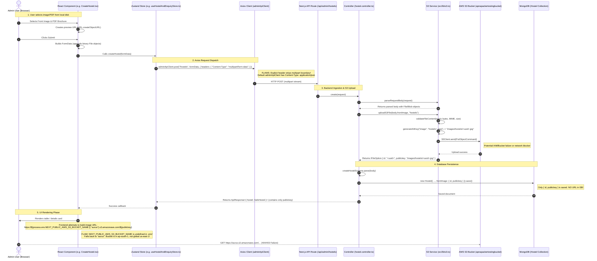

# AWS S3 Media & File Handling Analysis: Architecture, Flow & Root Cause Report

## 1. Executive Summary

This document presents a comprehensive, end-to-end technical analysis of how media files (images, icons, and PDF brochures) are handled across the Aurus application (City, Hostel, Blog, Story, Amenity, and Occupancy modules).

It answers the three critical questions raised:
1. **Why images and PDF files do not appear in the AWS S3 Portal bucket.**
2. **Why complete URLs are not stored in the MongoDB database.**
3. **Why uploaded images and files fail to render in the user interface (UI).**

> [!NOTE]
> As requested, **no code has been modified**. This document provides the complete architectural structure, data flow, underlying causes, and actionable recommendations.

---

## 2. End-to-End Media Flow & System Architecture



---

## 3. Deep-Dive Root Cause Analysis

### Question 1: Why do I not see images or files in my AWS S3 Portal bucket?

There are three primary reasons why files may fail to reach the AWS S3 bucket:

#### 1.1. Axios Multipart Boundary Stripping in Zustand Stores
In [`src/store/useMasterStore.ts`](file:///d:/MyWork/Buzzlink/aurus/src/store/useMasterStore.ts#L320-L323) and [`src/store/useHostelAndEnquiryStore.ts`](file:///d:/MyWork/Buzzlink/aurus/src/store/useHostelAndEnquiryStore.ts#L243-L247):
```typescript
const isFormData = typeof FormData !== "undefined" && input instanceof FormData;
const res = await adminApiClient.post<ApiResponse<{ hostel: SafeHostel }>>(
  "/hostels",
  input,
  isFormData ? { headers: { "Content-Type": "multipart/form-data" } } : undefined
);
```
**Why this breaks uploads:**
- Modern browsers automatically generate a multipart boundary delimiter when sending `FormData` (e.g., `multipart/form-data; boundary=----WebKitFormBoundary7MA4YWxkTrZu0gW`).
- By manually specifying `{ headers: { "Content-Type": "multipart/form-data" } }`, Axios removes the boundary parameter from the `Content-Type` header.
- Without the boundary delimiter, the server's HTTP parser (`request.formData()`) cannot parse the payload parts.
- Furthermore, `adminApiClient` in [`src/lib/admin-api.ts`](file:///d:/MyWork/Buzzlink/aurus/src/lib/admin-api.ts#L12-L18) defines a global default header:
  ```typescript
  export const adminApiClient = axios.create({
    baseURL: "/api/admin",
    headers: { "Content-Type": "application/json" },
    withCredentials: true,
  });
  ```
  If Axios falls back to `application/json`, the request body cannot be read as `FormData`, `request.formData()` fails, and the fallback `request.json()` returns an empty object, causing file objects to never reach `uploadS3File()`.

#### 1.2. Uncaught AWS Exceptions & IAM Permission Barriers
In [`src/lib/s3.ts`](file:///d:/MyWork/Buzzlink/aurus/src/lib/s3.ts#L315-L327):
```typescript
const command = new PutObjectCommand({
  Bucket: config.bucket,
  Key: key,
  Body: buffer,
  ContentType: mimeType,
  Metadata: {
    originalName: encodeURIComponent(originalName),
    uploadedAt: new Date().toISOString(),
  },
});

await client.send(command);
```
- `uploadFileToS3` executes `await client.send(command)` directly without a local `try/catch`.
- If the IAM User (`AWS_ACCESS_KEY_ID` configured in `.env`) lacks the `s3:PutObject` permission on `arn:aws:s3:::apnapackertestingbucket/*`, AWS immediately returns an `AccessDenied (403)` error.
- If the bucket name in `.env` (`apnapackertestingbucket`) does not match the exact bucket in your AWS portal or was created in a different account, AWS returns `NoSuchBucket (404)`.
- When this occurs, the controller's `try/catch` catches the error and returns a generic `500 Internal Server Error`, aborting the database save and uploading nothing.

#### 1.3. Optional File Submission Paths
- In [`src/components/admin/city/CreateCity.tsx`](file:///d:/MyWork/Buzzlink/aurus/src/components/admin/city/CreateCity.tsx#L144-L167), if the user does not select a file, the form sends a standard JSON payload (`selectedFile === null`).
- In that scenario, `body.image` is `undefined`, `uploadS3File` is skipped, and no file is transmitted to AWS S3.

---

### Question 2: Why is the complete URL not stored in the MongoDB Database?

The absence of full URLs in MongoDB is an **intentional cloud-native architectural pattern**, but with a missing dynamic resolution layer:

#### 2.1. The `IFileOption` Data Contract
Across all models ([`src/models/hostel.model.ts`](file:///d:/MyWork/Buzzlink/aurus/src/models/hostel.model.ts#L33-L39), [`src/models/city.model.ts`](file:///d:/MyWork/Buzzlink/aurus/src/models/city.model.ts#L45-L51), [`src/models/blog.model.ts`](file:///d:/MyWork/Buzzlink/aurus/src/models/blog.model.ts#L35-L41)):
```typescript
const HostelFileSchema = new Schema<IFileOption>(
  {
    id: { type: String, required: true, trim: true },
    publickey: { type: String, required: true, trim: true },
  },
  { _id: false }
);
```
The database stores only:
```json
{
  "id": "7f9a2e31-8c4d-4b8a-9e1f-6a7b8c9d0e1f",
  "publickey": "images/hostels/17406859345-abcdef1234567890.jpg"
}
```

#### 2.2. Architectural Rationale: Why Storing Full URLs in DB is an Anti-Pattern
1. **Decoupling from Infrastructure Changes**:
   If the full URL `https://apnapackertestingbucket.s3.ap-south-1.amazonaws.com/images/...` were stored in MongoDB, changing the bucket name, switching AWS accounts, or migrating to a production bucket (`aurus-production-bucket`) would invalidate thousands of database records, requiring expensive database migrations.
2. **CloudFront CDN Integration**:
   When connecting CloudFront (e.g., `https://cdn.aurushostels.com`), the application only needs to update its URL builder configuration, while database keys remain untouched.
3. **Private Buckets & Presigned URLs**:
   Production AWS S3 buckets are private. Private buckets require signed URLs that expire after 15 to 60 minutes. Because signed URLs have a finite lifespan, they cannot be stored statically in a database.

#### 2.3. The Missing Server-Side Resolution Layer
While [`src/lib/s3.ts`](file:///d:/MyWork/Buzzlink/aurus/src/lib/s3.ts#L236-L270) includes `getFileUrl(key)` to resolve full or presigned URLs, **the API controllers do not call it when formatting response DTOs**:
In `formatSafeCity` ([`src/controllers/city.controller.ts`](file:///d:/MyWork/Buzzlink/aurus/src/controllers/city.controller.ts#L36-L41)):
```typescript
image: doc.image
  ? {
      id: doc.image.id,
      publickey: doc.image.publickey,
    }
  : undefined
```
The controller returns only `{ id, publickey }`, passing the burden of URL construction to the client.

---

### Question 3: Why does the UI not render images or PDF files?

Even when a file key is successfully recorded, the UI cannot display it due to three compounding frontend issues:

#### 3.1. Missing `NEXT_PUBLIC_` Environment Variable Prefix
Look at the frontend components (e.g. [`src/components/admin/hostel/EditHostel.tsx`](file:///d:/MyWork/Buzzlink/aurus/src/components/admin/hostel/EditHostel.tsx#L69-L74), [`src/components/admin/city/CityManage.tsx`](file:///d:/MyWork/Buzzlink/aurus/src/components/admin/city/CityManage.tsx#L369)):
```typescript
const getS3Url = (key?: string) => {
  if (!key) return null;
  return key.startsWith("http")
    ? key
    : `https://${process.env.NEXT_PUBLIC_AWS_S3_BUCKET_NAME || "aurus"}.s3.amazonaws.com/${key}`;
};
```
Now look at your project's [`.env`](file:///d:/MyWork/Buzzlink/aurus/.env#L17-L22):
```properties
# AWS S3 Configuration
AWS_REGION=ap-south-1
AWS_ACCESS_KEY_ID=YOUR_AWS_ACCESS_KEY_ID
AWS_SECRET_ACCESS_KEY=YOUR_AWS_SECRET_ACCESS_KEY
AWS_S3_BUCKET_NAME=apnapackertestingbucket
```
- In Next.js, **only variables prefixed with `NEXT_PUBLIC_` are bundled into client-side JavaScript (`"use client"`)**.
- `AWS_S3_BUCKET_NAME` has no `NEXT_PUBLIC_` prefix, so inside the browser, `process.env.NEXT_PUBLIC_AWS_S3_BUCKET_NAME` evaluates to `undefined`.
- The code falls back to `"aurus"`.
- The browser attempts to fetch:
  ```text
  https://aurus.s3.amazonaws.com/images/hostels/...
  ```
  This is a completely different, nonexistent, or inaccessible bucket, resulting in immediate HTTP 404/403 network errors.

#### 3.2. Missing AWS Region in S3 URL Construction
- Your bucket is located in region `ap-south-1` (Mumbai).
- Buckets outside `us-east-1` require the regional endpoint:
  ```text
  https://<bucket-name>.s3.ap-south-1.amazonaws.com/<key>
  ```
- The frontend hardcodes `.s3.amazonaws.com` (the global / US Standard endpoint). When accessing buckets in `ap-south-1` via the global endpoint, AWS responds with `301 Moved Permanently` or `400 Bad Request`.

#### 3.3. AWS S3 "Block Public Access" & CORS Policies
By default, all modern AWS S3 buckets enable **Block Public Access**:
- If `apnapackertestingbucket` has Block Public Access turned ON, any unauthenticated HTTP request from a browser `` is blocked with:
  ```xml
  <Error>
    <Code>AccessDenied</Code>
    <Message>Access Denied</Message>
  </Error>
  ```
- Additionally, if CORS (Cross-Origin Resource Sharing) is not enabled on the S3 bucket for `http://localhost:3000`, the browser will reject image and PDF loads.

---

## 4. Code Inventory: Where Media is Managed

| Module | Frontend Form / Component | Store Method | API Route | Controller Handler | S3 Method |
| :--- | :--- | :--- | :--- | :--- | :--- |
| **City** | `CreateCity.tsx`<br/>`EditCity.tsx` | `useMasterStore.createCity`<br/>`updateCity` | `POST /api/admin/cities`<br/>`PATCH /api/admin/cities/[id]` | `city.controller.ts` (`create`, `update`) | `uploadS3File(..., "cities")` |
| **Hostel** | `CreateHostel.tsx`<br/>`EditHostel.tsx` | `useHostelAndEnquiryStore.createHostel`<br/>`updateHostel` | `POST /api/admin/hostels`<br/>`PATCH /api/admin/hostels/[id]` | `hostel.controller.ts` (`create`, `update`) | `uploadS3File(..., "hostels")`<br/>`uploadMultipleS3Files(..., "hostels")` |
| **Amenity** | `CreateAmenity.tsx`<br/>`EditAmenity.tsx` | `useMasterStore.createAmenity`<br/>`updateAmenity` | `POST /api/admin/amenities`<br/>`PATCH /api/admin/amenities/[id]` | `amenity.controller.ts` (`create`, `update`) | `uploadS3File(..., "amenities")` |
| **Occupancy** | `CreateOccupancy.tsx`<br/>`EditOccupancy.tsx` | `useMasterStore.createOccupancy`<br/>`updateOccupancy` | `POST /api/admin/occupancies`<br/>`PATCH /api/admin/occupancies/[id]` | `occupancy.controller.ts` (`create`, `update`) | `uploadS3File(..., "occupancies")` |
| **Blog** | `CreateBlog.tsx`<br/>`EditBlog.tsx` | `useContentStore.createBlog`<br/>`updateBlog` | `POST /api/admin/blogs`<br/>`PATCH /api/admin/blogs/[id]` | `blog.controller.ts` (`create`, `update`) | `uploadS3File(..., "blogs")` |
| **Story** | `CreateStory.tsx`<br/>`EditStory.tsx` | `useContentStore.createStory`<br/>`updateStory` | `POST /api/admin/stories`<br/>`PATCH /api/admin/stories/[id]` | `story.controller.ts` (`create`, `update`) | `uploadS3File(..., "stories")` |

---

## 5. Summary of Key Factors & Recommended Fix Roadmap

```
                                      CURRENT STATE                                                    RECOMMENDED FIX
                     +----------------------------------------------+                 +-----------------------------------------------+
                     |                                              |                 |                                               |
                     | .env:                                        |                 | .env:                                         |
1. Environment       | AWS_S3_BUCKET_NAME=apnapackertestingbucket   |  ===========>   | NEXT_PUBLIC_AWS_S3_BUCKET_NAME=apnapacker...  |
   Variables         | (Client sees undefined -> falls to "aurus")  |                 | NEXT_PUBLIC_AWS_REGION=ap-south-1             |
                     |                                              |                 |                                               |
                     +----------------------------------------------+                 +-----------------------------------------------+

                     +----------------------------------------------+                 +-----------------------------------------------+
                     |                                              |                 |                                               |
2. Axios Upload      | headers: { "Content-Type": "multipart/..." } |  ===========>   | Omit Content-Type when sending FormData       |
   Headers           | (Strips multipart boundary delimiter)        |                 | (Browser automatically sets boundary)         |
                     |                                              |                 |                                               |
                     +----------------------------------------------+                 +-----------------------------------------------+

                     +----------------------------------------------+                 +-----------------------------------------------+
                     |                                              |                 |                                               |
3. URL Construction  | https://aurus.s3.amazonaws.com/<key>         |  ===========>   | https://<bucket>.s3.<region>.amazonaws.com/...|
   in UI             | (Wrong bucket, missing ap-south-1 region)    |                 | (Or unified getMediaUrl() utility helper)     |
                     |                                              |                 |                                               |
                     +----------------------------------------------+                 +-----------------------------------------------+

                     +----------------------------------------------+                 +-----------------------------------------------+
                     |                                              |                 |                                               |
4. AWS S3 Bucket     | Block Public Access: ON (Default)            |  ===========>   | Configure S3 Bucket Policy for public read    |
   Permissions       | CORS: Not configured                         |                 | OR use CloudFront CDN distribution / presign  |
                     |                                              |                 |                                               |
                     +----------------------------------------------+                 +-----------------------------------------------+
```

### Actionable Checkpoints:

1. **Environment Variables**:
   Add public prefixes to [`.env`](file:///d:/MyWork/Buzzlink/aurus/.env):
   ```properties
   NEXT_PUBLIC_AWS_S3_BUCKET_NAME=apnapackertestingbucket
   NEXT_PUBLIC_AWS_REGION=ap-south-1
   ```

2. **Axios Client Configuration**:
   In `adminApiClient`, ensure that when sending `FormData`, the `Content-Type` header is not overridden, allowing the browser to append the boundary string:
   ```typescript
   // In store API calls:
   const headers = isFormData ? { "Content-Type": undefined } : undefined;
   ```

3. **Shared Frontend S3 URL Helper**:
   Create a centralized helper `getMediaUrl(key)` instead of repeating inline string templates across 12 different files:
   ```typescript
   export function getMediaUrl(key?: string): string | null {
     if (!key) return null;
     if (key.startsWith("http")) return key;
     const bucket = process.env.NEXT_PUBLIC_AWS_S3_BUCKET_NAME || "apnapackertestingbucket";
     const region = process.env.NEXT_PUBLIC_AWS_REGION || "ap-south-1";
     return `https://${bucket}.s3.${region}.amazonaws.com/${key}`;
   }
   ```

4. **AWS Portal Bucket Policy (for Public Media)**:
   If media files should be publicly viewable by visitors on the website, configure the bucket policy in the AWS S3 Console:
   ```json
   {
     "Version": "2012-10-17",
     "Statement": [
       {
         "Sid": "PublicReadGetObject",
         "Effect": "Allow",
         "Principal": "*",
         "Action": "s3:GetObject",
         "Resource": "arn:aws:s3:::apnapackertestingbucket/*"
       }
     ]
   }
   ```

5. **AWS S3 CORS Configuration**:
   Add CORS permissions in the AWS S3 Console under Permissions -> Cross-origin resource sharing (CORS):
   ```json
   [
     {
       "AllowedHeaders": ["*"],
       "AllowedMethods": ["GET", "HEAD"],
       "AllowedOrigins": ["http://localhost:3000", "https://*.yourdomain.com"],
       "ExposeHeaders": []
     }
   ]
   ```

