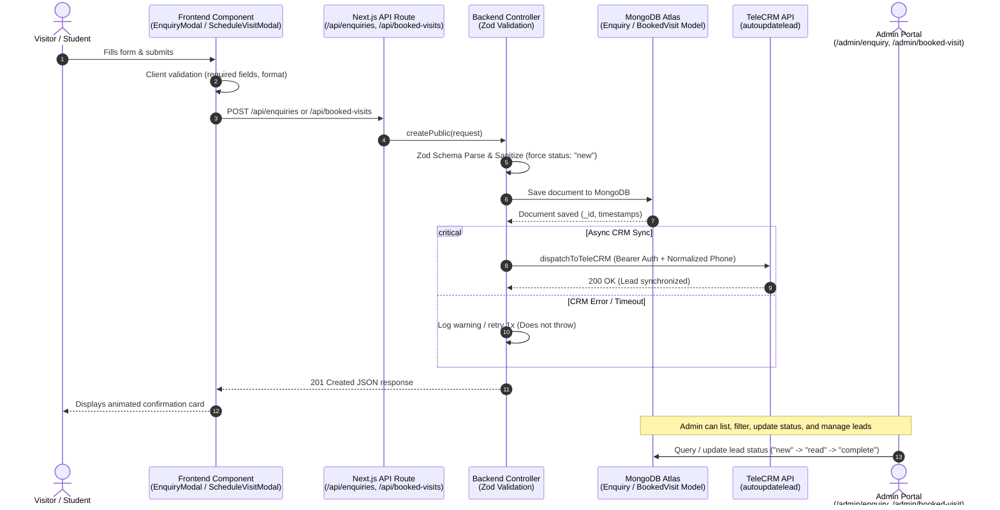

# Aurus - Forms & TeleCRM Integration Guide

This document provides a comprehensive technical overview and operational guide for the two primary lead generation systems in Aurus:
1. **General Enquiry Form** (`Enquiry`)
2. **Schedule a Visit Form** (`Booked Visit`)

It details the end-to-end data pipeline: from frontend user interactions and client validation to backend Next.js API endpoints, Zod schema validation, MongoDB persistence, Admin Panel management, and automated real-time dispatch to **TeleCRM**.

---

## Table of Contents

1. [Architecture & System Flow Overview](#1-architecture--system-flow-overview)
2. [Enquiry Form System](#2-enquiry-form-system)
   - [Purpose & Triggers](#purpose--triggers)
   - [Frontend Components](#frontend-components)
   - [Data Schema & Validation Rules](#data-schema--validation-rules)
   - [API Endpoints](#api-endpoints)
   - [Database Model](#database-model)
   - [Admin Management Panel](#admin-management-panel)
3. [Booked Visit Form System](#3-booked-visit-form-system)
   - [Purpose & Triggers](#purpose--triggers-1)
   - [Frontend Components](#frontend-components-1)
   - [Data Schema & Validation Rules](#data-schema--validation-rules-1)
   - [API Endpoints](#api-endpoints-1)
   - [Database Model](#database-model-1)
   - [Admin Management Panel](#admin-management-panel-1)
4. [TeleCRM Integration Details](#4-telecrm-integration-details)
   - [Service Location & Architecture](#service-location--architecture)
   - [API Endpoint & Authentication](#api-endpoint--authentication)
   - [Non-Blocking & Resilient Execution Flow](#non-blocking--resilient-execution-flow)
   - [Phone Number Normalization (`formatPhoneForTeleCRM`)](#phone-number-normalization-formatphonefortelecrm)
   - [Payload Mapping: Enquiry vs Booked Visit](#payload-mapping-enquiry-vs-booked-visit)
   - [Timeout, Retry Mechanics & Error Handling](#timeout-retry-mechanics--error-handling)
5. [Environment Variables & Configuration](#5-environment-variables--configuration)
6. [Testing, Seeding & Troubleshooting](#6-testing-seeding--troubleshooting)

---

## 1. Architecture & System Flow Overview

Both lead capture mechanisms follow an asynchronous, decoupled architecture to ensure that user-facing submissions are never delayed or failed by external CRM downtimes or network latency.

### End-to-End Sequence Diagram



---

## 2. Enquiry Form System

### Purpose & Triggers
The Enquiry system captures prospective students, parents, or working professionals seeking general information regarding hostels, room categories, dining, amenities, pricing, or custom questions.

**Entry Points on Website:**
- **Global Modal Trigger**: Click on any "Enquire Now" or "Get in Touch" buttons located across navigation headers, hero banners, and residence detail pages.
- **Embedded Contact Page Form**: Inline form located on the `/contact` page under "Request a Callback / Talk to Us".
- **Managed Hostels Callback Section**: Dedicated callback enquiry form on the `/managed-hostels` page for GIFT City residences.
- **Developers & Landowners Form**: Institutional property submission and partnership enquiry form on the `/developers` page.
- **Operator Operations Form**: Dedicated property operations enquiry form on the `/operator` page ("Talk to Our Operations Team").

---

### Frontend Components

1. **Global Modal Component**: [`src/components/shared/EnquiryModal.tsx`](file:///d:/MyWork/Buzzlink/aurus/src/components/shared/EnquiryModal.tsx)
   - Rendered into a React Portal (`createPortal(..., document.body)`).
   - Locks background scroll (`document.body.style.overflow = "hidden"`).
   - Closes on `Escape` key or backdrop click (prevented during submission).
   - Dynamically fetches available cities from `useMasterStore.fetchPublicCities()` with sensible fallbacks (`["Mumbai", "Noida", "Ahmedabad", "Pune", "Jalandhar"]`).
   - Displays animated confirmation screen on success and automatically dismisses after 2.5 seconds.

2. **Inline Contact Form**: [`src/components/contact/CallbackForm.tsx`](file:///d:/MyWork/Buzzlink/aurus/src/components/contact/CallbackForm.tsx)
   - Reusable standalone form embedded directly inside the `/contact` page.
   - Clears inputs upon submission and surfaces an in-page toast alert.

3. **Managed Hostels Callback Section**: [`src/components/managed-hostels/CallbackSection.tsx`](file:///d:/MyWork/Buzzlink/aurus/src/components/managed-hostels/CallbackSection.tsx)
   - Embedded enquiry form styled with dark aesthetic on `/managed-hostels`.
   - Uses the unified Enquiry schema (`name`, `number`, `email`, `hostelCity`, `gender`, `message`, `status: "new"`).
   - Fetches dynamic public cities with `"Ahmedabad"` initial city default.

4. **Developers Project Submission Form**: [`src/components/developers/SubmitProjectForm.tsx`](file:///d:/MyWork/Buzzlink/aurus/src/components/developers/SubmitProjectForm.tsx)
   - Partnerships and property submission form embedded on `/developers`.
   - Uses the unified Enquiry schema (`name`, `number`, `email`, `hostelCity`, `gender`, `message`, `status: "new"`).
   - Posts directly to `/api/enquiries`, saving to MongoDB and synchronizing lead to TeleCRM.

5. **Operator Page Operations Form**: [`src/components/operator/TalkToOperationsForm.tsx`](file:///d:/MyWork/Buzzlink/aurus/src/components/operator/TalkToOperationsForm.tsx)
   - Property operations and co-living management enquiry form embedded on `/operator`.
   - Uses the unified Enquiry schema (`name`, `number`, `email`, `hostelCity`, `gender`, `message`, `status: "new"`).
   - Features dynamic public cities selection via `useMasterStore.fetchPublicCities()`, full client validation, and real-time TeleCRM sync through `/api/enquiries`.

---

### Data Schema & Validation Rules

Client-side and server-side validation is enforced with **Zod** in [`src/validations/enquiry.validation.ts`](file:///d:/MyWork/Buzzlink/aurus/src/validations/enquiry.validation.ts):

| Field Name | Type | Required | Rules & Constraints | Description |
| :--- | :--- | :--- | :--- | :--- |
| `name` | `string` | Yes | Required, trimmed, 1–100 characters | Full name of the applicant |
| `number` | `string` | Yes | Required, 7–20 characters, regex: `/^\+?[0-9\s\-()]{7,20}$/` | Mobile phone number |
| `email` | `string` | No | Optional, valid email format if entered, lowercased, max 255 chars | User's email address |
| `hostelCity` | `string` | Yes | Required, trimmed, 1–100 characters | Selected hostel city |
| `gender` | `enum` | Yes | Strictly `"boys"` or `"girls"` | Hostel gender category |
| `message` | `string` | No | Optional, trimmed, max 2000 characters | Additional enquiry message |
| `status` | `enum` | Yes | `"new" \| "read" \| "complete"` | Defaults to `"new"`. Public submissions forced to `"new"` |

---

### API Endpoints

#### 1. Public API Endpoint
- **URL**: `POST /api/enquiries`
- **Handler**: [`src/app/api/enquiries/route.ts`](file:///d:/MyWork/Buzzlink/aurus/src/app/api/enquiries/route.ts) -> calls `createPublic` in [`src/controllers/enquiry.controller.ts`](file:///d:/MyWork/Buzzlink/aurus/src/controllers/enquiry.controller.ts).
- **Authentication**: None (Public).
- **Behavior**:
  - Always overrides `status` to `"new"` regardless of client input.
  - Persists record into MongoDB.
  - Triggers non-blocking `sendEnquiryToTeleCRM(...)`.
  - Returns `201 Created` with the newly created safe enquiry payload.

#### 2. Admin Management Endpoints
- **Base Route**: `/api/admin/enquiries`
- **Controller**: [`src/controllers/enquiry.controller.ts`](file:///d:/MyWork/Buzzlink/aurus/src/controllers/enquiry.controller.ts)
- **Protected By**: `authenticateAdmin` JWT middleware.

| Method | Endpoint | Description |
| :--- | :--- | :--- |
| `GET` | `/api/admin/enquiries` | Paginated listing with search (`name`, `number`, `email`, `hostelCity`, `message`), status filter (`new`, `read`, `complete`, `all`), gender filter (`boys`, `girls`, `all`), and sorting. |
| `POST` | `/api/admin/enquiries` | Create an enquiry manually from the admin panel. |
| `GET` | `/api/admin/enquiries/[id]` | Fetch single enquiry by MongoDB ObjectId. |
| `PATCH` | `/api/admin/enquiries/[id]` | Update enquiry fields or change status (e.g., mark as `read` or `complete`). |
| `DELETE` | `/api/admin/enquiries/[id]` | Delete an enquiry record. |

---

### Database Model

Defined in [`src/models/enquiry.model.ts`](file:///d:/MyWork/Buzzlink/aurus/src/models/enquiry.model.ts):
- **Collection Name**: `enquiries`
- **Fields**:
  - `name`: `String`, required, maxlength 100.
  - `number`: `String`, required, maxlength 20.
  - `email`: `String`, optional, maxlength 255.
  - `hostelCity`: `String`, required, indexed, maxlength 100.
  - `gender`: `String`, required, enum `["boys", "girls"]`, indexed.
  - `message`: `String`, optional, maxlength 2000.
  - `status`: `String`, enum `["new", "read", "complete"]`, default `"new"`, indexed.
  - `createdAt`, `updatedAt`: Automatic ISO timestamps.
- **Indexes**:
  - `{ createdAt: -1 }`: Quick chronological ordering.
  - `{ status: 1, createdAt: -1 }`: Fast filtering by lead state.
  - `{ hostelCity: 1, createdAt: -1 }`: City-based indexing.

---

### Admin Management Panel

- **URL**: `/admin/enquiry`
- **Main Container**: [`src/components/admin/enquiry/EnquiryManage.tsx`](file:///d:/MyWork/Buzzlink/aurus/src/components/admin/enquiry/EnquiryManage.tsx)
- **Sub-components**:
  - `EnquiryHeader.tsx`: Title and action controls.
  - `EnquiryDetails.tsx`: Displays full lead details: name, phone, email, hostel city, gender, message, timestamp, and quick status changer.
  - `EditEnquiry.tsx`: Allows administrators to edit lead fields or change status (`new` -> `read` -> `complete`).
  - `CreateEnquiry.tsx`: Manual lead creation.
  - `DeleteEnquiry.tsx`: Safe confirmation dialog prior to permanent removal.

---

## 3. Booked Visit Form System

### Purpose & Triggers
The Booked Visit system captures prospective students and parents who want to physically visit a hostel property or schedule a walkthrough.

**Entry Points on Website:**
- **Residence Cards**: "Schedule a Visit" button on listing cards.
- **Residence Detail Page**: Primary CTA on `/hostel-details/[slug]` pages.
- Automatically passes `residenceTitle` and `initialCity`.

---

### Frontend Components

1. **Schedule Visit Modal**: [`src/components/shared/ScheduleVisitModal.tsx`](file:///d:/MyWork/Buzzlink/aurus/src/components/shared/ScheduleVisitModal.tsx)
   - Rendered using React Portal (`createPortal(..., document.body)`).
   - Date picker enforces `min={new Date().toISOString().split("T")[0]}` to prevent past date selections.
   - Dynamic hostel city dropdown from `useMasterStore.fetchPublicCities()`.
   - Required `collegeName` and optional `email` fields.
   - Success view states: *"Visit Request Received: Our residence manager will reach out within 2 hours to confirm your visit."*

---

### Data Schema & Validation Rules

Defined in [`src/validations/booked-visit.validation.ts`](file:///d:/MyWork/Buzzlink/aurus/src/validations/booked-visit.validation.ts):

| Field Name | Type | Required | Rules & Constraints | Description |
| :--- | :--- | :--- | :--- | :--- |
| `name` | `string` | Yes | Required, trimmed, 1–100 characters | Visitor's full name |
| `number` | `string` | Yes | Required, 7–20 characters, regex: `/^\+?[0-9\s\-()]{7,20}$/` | Mobile contact number |
| `email` | `string` | No | Optional, valid email format if entered, lowercased, max 255 chars | Visitor's email |
| `hostelCity` | `string` | Yes | Required, trimmed, 1–100 characters | Selected hostel city |
| `collegeName` | `string` | Yes | Required, trimmed, 1–200 characters | College or university name |
| `wantToVisit` | `Date/String` | Yes | Required, valid date string (e.g. `YYYY-MM-DD`) | Preferred visit date |
| `status` | `enum` | Yes | `"new" \| "read" \| "complete"` | Defaults to `"new"` |

---

### API Endpoints

#### 1. Public API Endpoint
- **URL**: `POST /api/booked-visits`
- **Handler**: [`src/app/api/booked-visits/route.ts`](file:///d:/MyWork/Buzzlink/aurus/src/app/api/booked-visits/route.ts) -> calls `createPublic` in [`src/controllers/booked-visit.controller.ts`](file:///d:/MyWork/Buzzlink/aurus/src/controllers/booked-visit.controller.ts).
- **Authentication**: None (Public).
- **Behavior**:
  - Forces `status: "new"`.
  - Persists record into MongoDB with ISO `wantToVisit`.
  - Forwards lead asynchronously to TeleCRM via `sendBookedVisitToTeleCRM(...)`.
  - Returns `201 Created`.

#### 2. Admin Management Endpoints
- **Base Route**: `/api/admin/booked-visits`
- **Controller**: [`src/controllers/booked-visit.controller.ts`](file:///d:/MyWork/Buzzlink/aurus/src/controllers/booked-visit.controller.ts)
- **Protected By**: `authenticateAdmin` JWT middleware.

| Method | Endpoint | Description |
| :--- | :--- | :--- |
| `GET` | `/api/admin/booked-visits` | Paginated listing with search (`name`, `number`, `email`, `collegeName`, `hostelCity`), status filter, visit date filter, and sorting. |
| `POST` | `/api/admin/booked-visits` | Manual booking creation by staff. |
| `GET` | `/api/admin/booked-visits/[id]` | Fetch single booking by ID. |
| `PATCH` | `/api/admin/booked-visits/[id]` | Update visit schedule, contact details, or mark status (`read`, `complete`). |
| `DELETE` | `/api/admin/booked-visits/[id]` | Remove booking. |

---

### Database Model

Defined in [`src/models/booked-visit.model.ts`](file:///d:/MyWork/Buzzlink/aurus/src/models/booked-visit.model.ts):
- **Collection Name**: `bookedvisits`
- **Fields**:
  - `name`: `String`, required, maxlength 100.
  - `number`: `String`, required, maxlength 20.
  - `email`: `String`, optional, lowercase, maxlength 255.
  - `hostelCity`: `String`, required, indexed, maxlength 100.
  - `collegeName`: `String`, required, maxlength 200.
  - `wantToVisit`: `Date`, required, indexed.
  - `status`: `String`, enum `["new", "read", "complete"]`, default `"new"`.
  - `createdAt`, `updatedAt`: Automatic ISO timestamps.
- **Indexes**:
  - `{ createdAt: -1 }`: Quick chronological ordering.
  - `{ status: 1, createdAt: -1 }`: Status-based queries.
  - `{ hostelCity: 1, wantToVisit: 1 }`: Fast scheduling lookups per city.
  - `{ wantToVisit: 1 }`: Calendar query index.

---

### Admin Management Panel

- **URL**: `/admin/booked-visit`
- **Main Container**: [`src/components/admin/booked-visit/BookedVisitManage.tsx`](file:///d:/MyWork/Buzzlink/aurus/src/components/admin/booked-visit/BookedVisitManage.tsx)
- **Sub-components**:
  - `BookedVisitHeader.tsx`: Title, status counts, and export/add buttons.
  - `BookedVisitDetails.tsx`: Detailed modal with name, phone, email, hostel city, college name, scheduled visit date, and quick action buttons.
  - `EditBookedVisit.tsx`: Rescheduling dates or updating lead status.
  - `CreateBookedVisit.tsx`: Admin-initiated visit entry.
  - `DeleteBookedVisit.tsx`: Deletion confirmation.

---

## 4. TeleCRM Integration Details

### Service Location & Architecture
All TeleCRM communication is centralized in [`src/services/telecrm.service.ts`](file:///d:/MyWork/Buzzlink/aurus/src/services/telecrm.service.ts).

---

### API Endpoint & Authentication

- **Endpoint Type**: TeleCRM Enterprise *Auto Update Lead* API
- **URL Pattern**:
  ```http
  POST https://next-api.telecrm.in/enterprise/{enterprise_id}/autoupdatelead
  ```
- **HTTP Headers**:
  ```http
  Content-Type: application/json
  Authorization: Bearer <TELECRM_API_KEY>
  ```
- **Configuration**:
  - `TELECRM_API_URL`: Configured in `.env` (contains enterprise ID).
  - `TELECRM_API_KEY`: Secret bearer token generated from TeleCRM settings.

---

### Non-Blocking & Resilient Execution Flow

To protect user experience:
1. The visitor submission is written to MongoDB **first**.
2. **Development Environment Bypass**: When `NODE_ENV=development`, external calls to TeleCRM are safely bypassed. Lead data and TeleCRM payloads are logged using `createLogger` (`TeleCRMService`) for inspection, preventing test submissions from populating live CRM pipelines.
3. The TeleCRM push runs in an isolated `try/catch` block.
4. If TeleCRM fails, times out, or returns an error in production, the error is written to structured server logs via [`src/lib/logger.ts`](file:///d:/MyWork/Buzzlink/aurus/src/lib/logger.ts) but **does not break the user flow**. The user receives HTTP `201 Created` immediately.

---

### Phone Number Normalization (`formatPhoneForTeleCRM`)

TeleCRM strictly requires mobile numbers formatted with the country code followed by digits without spaces, hyphens, parentheses, or a leading `+` sign (e.g. `919876543210` for India).

[`formatPhoneForTeleCRM`](file:///d:/MyWork/Buzzlink/aurus/src/services/telecrm.service.ts#L47-L63) handles this automatically:

```typescript
export function formatPhoneForTeleCRM(raw: string): string {
  if (!raw) return "";
  const digits = raw.replace(/\D/g, "");

  // 10-digit standard Indian mobile number -> prefix 91
  if (digits.length === 10) {
    return `91${digits}`;
  }

  // 11-digit number starting with leading 0 (e.g., 09876543210) -> replace 0 with 91
  if (digits.length === 11 && digits.startsWith("0")) {
    return `91${digits.slice(1)}`;
  }

  // Already prefixed with country code (e.g. 919876543210) or international
  return digits;
}
```

---

### Payload Mapping: Enquiry vs Booked Visit

#### A. Enquiry Lead Payload Mapping
| Aurus Field | TeleCRM Field |
| :--- | :--- |
| `name` | `name` |
| `number` | `phone` |
| `email` | `email` |
| `hostelCity` | `hostel_city` |
| `gender` | `gender` |
| `message` | `message` |
| `status` | `status` |

Example JSON:
```json
{
  "fields": {
    "name": "Aarav Sharma",
    "phone": "919876511223",
    "email": "aarav.sharma@example.com",
    "hostel_city": "Pune",
    "gender": "boys",
    "message": "Looking for single occupancy room...",
    "status": "new",
    "source": "Website Enquiry",
    "lead_source": "Website Enquiry"
  },
  "actions": [
    {
      "type": "SYSTEM_NOTE",
      "text": "Lead Source: Website Enquiry\nHostel City: Pune\nGender Category: Boys Hostel\nEmail: aarav.sharma@example.com\nMessage: Looking for single occupancy room..."
    }
  ]
}
```

#### B. Booked Visit Lead Payload Mapping
| Aurus Field | TeleCRM Field |
| :--- | :--- |
| `name` | `name` |
| `number` | `phone` |
| `email` | `email` |
| `hostelCity` | `hostel_city` |
| `collegeName` | `college_name` |
| `wantToVisit` | `want_to_visit` |
| `status` | `status` |

Example JSON:
```json
{
  "fields": {
    "name": "Tanvi Deshmukh",
    "phone": "919876543210",
    "email": "tanvi.deshmukh@example.com",
    "hostel_city": "Mumbai",
    "college_name": "NMIMS Mumbai",
    "want_to_visit": "Sat, Nov 23, 2026",
    "status": "new",
    "source": "Website Booked Visit",
    "lead_source": "Website Booked Visit"
  },
  "actions": [
    {
      "type": "SYSTEM_NOTE",
      "text": "Lead Type: Booked Visit (Website Booked Visit)\nHostel City: Mumbai\nWant to Visit: Sat, Nov 23, 2026\nCollege: NMIMS Mumbai\nEmail: tanvi.deshmukh@example.com"
    }
  ]
}
```

---

### Timeout, Retry Mechanics & Error Handling

[`dispatchToTeleCRM`](file:///d:/MyWork/Buzzlink/aurus/src/services/telecrm.service.ts#L69-L185) incorporates enterprise reliability safeguards:

1. **Missing Credentials Guard**:
   - If `TELECRM_API_URL` or `TELECRM_API_KEY` is undefined, dispatch returns `{ success: false, skipped: true }` without throwing.
2. **Request Timeout**:
   - Each HTTP request uses `AbortSignal.timeout(8000)` (8 seconds maximum per attempt).
3. **Automatic 1-Attempt Retry**:
   - In case of a `5xx` server error or network timeout, the service automatically waits `1000ms` and retries once (`maxAttempts = 2`).
4. **No-Retry on Client Errors (4xx)**:
   - If TeleCRM returns `400 Bad Request` or `401 Unauthorized`, it halts immediately.
5. **PII Masking**:
   - Server logs automatically mask the phone number (e.g. `*******3210`) using `.replace(/.(?=.{4})/g, "*")`.

---

## 5. Environment Variables & Configuration

```env
# TeleCRM Configuration
TELECRM_API_URL=https://next-api.telecrm.in/enterprise/{your_enterprise_id}/autoupdatelead
TELECRM_API_KEY=your_telecrm_bearer_token
```

---

## 6. Testing, Seeding & Troubleshooting

### Seed Sample Data
Mock data can be populated into MongoDB using the included seed scripts:

```bash
# Seed sample enquiries into MongoDB
npx tsx scripts/seed-enquiries.ts

# Seed sample booked visits into MongoDB
npx tsx scripts/seed-booked-visits.ts
```

### Migrate Legacy Records to New Schemas
To transform legacy MongoDB documents in `enquiries` and `bookedvisits` into the new schemas:

```bash
# 1. Preview changes (Dry Run - no DB writes):
npm run migrate:forms
# or
npx tsx scripts/migrate-forms-to-new-schema.ts --dry-run

# 2. Execute live migration in Development DB:
NODE_ENV=development npx tsx scripts/migrate-forms-to-new-schema.ts --execute

# 3. Execute live migration in Production DB:
NODE_ENV=production npx tsx scripts/migrate-forms-to-new-schema.ts --execute
```

### Troubleshooting Checklist

| Symptom | Probable Cause | Remedy |
| :--- | :--- | :--- |
| Form submits on website, but lead is NOT in TeleCRM | Missing `.env` variables | Verify `TELECRM_API_URL` and `TELECRM_API_KEY` exist in `.env` and restart the Next.js dev server. |
| Console shows `TeleCRM rejected lead with HTTP 401` | Invalid API Key | Re-generate the bearer token in TeleCRM settings and update `TELECRM_API_KEY`. |
| Console shows `TeleCRM rejected lead with HTTP 404` | Wrong Enterprise ID in URL | Ensure `{your_enterprise_id}` in the URL matches your actual TeleCRM enterprise ID. |
| Lead phone appears without +91 in TeleCRM | Number formatting | `formatPhoneForTeleCRM` strips non-digits and ensures `91` prefix. |
| User sees "Validation failed" | Zod schema mismatch | Check `number` length (min 7, max 20), gender (`boys` or `girls`), or required checkbox acceptance. |
